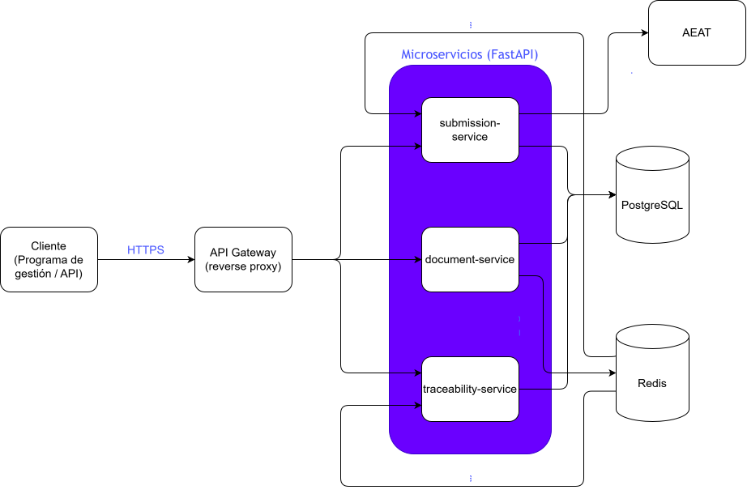

# verifactu-trace

Aplicación nativa de la nube para la emisión y la trazabilidad de facturación electrónica B2B, desarrollada como proyecto de prácticas de la asignatura *Cloud Computing: Fundamentos e Infraestructuras* (Máster en Ingeniería Informática, Universidad de Granada).

> **Estado:** Hito 1 completado.

## Índice

1. [Descripción del dominio y casos de uso](#descripción-del-dominio-y-casos-de-uso)
2. [Justificación NIST SP 800-145](#justificación-nist-sp-800-145)
3. [Actores NIST SP 500-292](#actores-nist-sp-500-292)
4. [Arquitectura](#arquitectura)
5. [Especificación de la API REST](#especificación-de-la-api-rest)
6. [Gestión del proyecto](#gestión-del-proyecto)
7. [Licencia](#licencia)

## Descripción del dominio y casos de uso

### Problema

La normativa española de facturación (Reglamento de requisitos de los sistemas informáticos de facturación, conocido como *Verifactu*) exige que el software que emite facturas genere un **registro por cada factura**, que ese registro quede **encadenado criptográficamente** con el anterior para que no pueda alterarse sin dejar rastro, y que pueda **remitirse a la Agencia Tributaria (AEAT)**.

Para una pyme o un despacho profesional esto supone tres problemas operativos:

1. **Emitir correctamente**: aplicar las reglas fiscales (numeración por serie, IVA, retenciones, facturas rectificativas) sin errores.
2. **Garantizar la integridad**: poder demostrar que ninguna factura emitida se ha modificado ni eliminado.
3. **Controlar el envío**: saber en todo momento si cada factura ha llegado a la AEAT, ha sido rechazada o está pendiente de reintento.

`verifactu-trace` es una plataforma de microservicios que cubre este ciclo y mantiene la **trazabilidad completa de cada documento**, desde su emisión hasta su aceptación o rechazo.

### Por qué es un problema para la nube

- **Carga irregular**: la emisión se concentra en cierres de mes y de trimestre, con picos que justifican elasticidad.
- **Disponibilidad**: un fallo del servicio de envío no debe impedir emitir facturas por lo que los envíos se reintentan de forma asíncrona.
- **Servicios independientes**: emisión, trazabilidad y envío tienen necesidades de escalado y fallo diferentes, lo que justifica separarlos.
- **Servicio medido**: el volumen de facturas procesadas es una métrica natural de uso.

### Base conceptual

El proyecto toma como base conceptual mi Trabajo de Fin de Grado, *Arquitectura para la Trazabilidad Documental y Detección de Cuellos de Botella en Redes B2B mediante Grafos y Generación Sintética* (Universidad de Burgos, julio de 2026; [repositorio](https://github.com/pablomatgom/TFG-B2B)). De él se reutiliza únicamente la idea de modelar la trazabilidad como una **cadena de documentos relacionados** (pedido, albarán, factura).

No se copia código del TFG ya que este proyecto resuelve un problema totalmente distinto. Mientras el TFG **analiza** redes B2B con grafos y datos sintéticos, `verifactu-trace` **opera** el ciclo de vida de facturas reales conforme a la normativa, con una arquitectura de microservicios pensada para desplegarse en la nube.

### Casos de uso principales

La cadena documental que se modela es **pedido → albarán → factura**, por lo que cada documento referencia al anterior, de forma que desde una factura se puede reconstruir su origen.

| Código | Caso de uso | Servicio | Prioridad |
|---|---|---|---|
| CU-1 | Registrar un pedido | `document-service` | MVP |
| CU-2 | Registrar un albarán que referencia a un pedido, validando que existe y que las cantidades no lo superan | `document-service` | MVP |
| CU-3 | Emitir una factura (líneas, impuestos y numeración por serie) que referencia a un albarán | `document-service` | MVP |
| CU-4 | Consultar un documento por su identificador | `document-service` | MVP |
| CU-5 | Listar documentos filtrando por tipo, cliente, serie, fechas o estado | `document-service` | MVP |
| CU-6 | Anular un pedido o un albarán que aún no ha sido facturado | `document-service` | Extra |
| CU-7 | Detectar discrepancias de cantidades o importes entre pedido, albarán y factura | `document-service` | Extra |
| CU-8 | Emitir una factura rectificativa que referencia a la factura original | `document-service` | Extra |
| CU-9 | Registrar cada evento de un documento con su hash encadenado | `traceability-service` | MVP |
| CU-10 | Verificar la integridad de la cadena de registros | `traceability-service` | MVP |
| CU-11 | Consultar la cadena documental completa de una factura (pedido → albarán → factura) | `traceability-service` | MVP |
| CU-12 | Consultar el histórico de eventos de un documento (auditoría) | `traceability-service` | MVP |
| CU-13 | Enviar una factura a la AEAT (simulada) con estados y reintentos automáticos | `submission-service` | MVP |
| CU-14 | Consultar el estado de envío de una factura | `submission-service` | MVP |
| CU-15 | Reintentar manualmente un envío fallido o rechazado | `submission-service` | Extra |
| CU-16 | Listar los envíos pendientes o fallidos | `submission-service` | Extra |

### Alcance del producto mínimo viable (MVP)

Incluye el registro de pedidos, albaranes y facturas con validación de sus referencias, el registro encadenado y su verificación, la consulta de la cadena documental y el envío simulado a la AEAT con reintentos. El producto se expone únicamente mediante la **API REST**. Los casos de uso marcados como *Extra* en la tabla anterior forman parte del backlog y se abordan si el tiempo lo permite.

Quedan **fuera** del MVP:

- La firma electrónica real y la integración con los servicios reales de la AEAT.
- La **interfaz web**. No forma parte del MVP, pero se contempla como una posible ampliación futura con un cliente sencillo sobre la API existente para consultar la cadena documental y el estado de envío.

## Justificación NIST SP 800-145

La definición de computación en la nube del NIST (SP 800-145) la caracteriza por cinco características esenciales. A continuación se analiza cómo las aprovecha `verifactu-trace` y qué decisión del proyecto las materializa.

| Característica (NIST) | Definición | Cómo la aprovecha `verifactu-trace` |
|---|---|---|
| **Autoservicio bajo demanda** | El consumidor aprovisiona capacidades de cómputo por sí mismo, sin interacción humana con el proveedor. | Un emisor puede darse de alta y empezar a registrar documentos a través de la API sin intervención de un operador. La infraestructura se describe como código, de modo que el entorno se crea y se destruye de forma automática. |
| **Acceso amplio a la red** | Las capacidades se ofrecen a través de la red mediante mecanismos estándar, para clientes heterogéneos. | Toda la funcionalidad se expone por **API REST sobre HTTP con JSON**, por lo que puede consumirla cualquier software de gestión, un ERP, un script o, en el futuro, una interfaz web. Al ampliarse la base de usuarios potenciales aumenta el riesgo de seguridad, por lo que el acceso se limita a emisores autenticados. |
| **Asignación común de recursos** | Los recursos del proveedor se agrupan para atender a varios consumidores (*multi-tenancy*), asignándose y reasignándose dinámicamente según la demanda. | Los servicios atienden a varios emisores sobre la misma infraestructura, y cada documento queda asociado a su emisor para aislar los datos. La virtualización mediante contenedores permite compartir los recursos del nodo donde se despliegan. |
| **Rápida elasticidad** | Las capacidades se aprovisionan y liberan de forma rápida y automática según la demanda; para el consumidor parecen ilimitadas. | Los picos de emisión de fin de mes o de trimestre se absorben con **escalabilidad horizontal**, añadiendo réplicas de los servicios sin estado y retirándolas cuando baja la demanda. El envío a la AEAT se desacopla mediante una cola, de modo que `submission-service` escala de forma independiente. |
| **Servicio medido** | El uso de recursos se monitoriza, controla y reporta, con transparencia para proveedor y consumidor (pago por uso). | Cada servicio expone métricas de uso (documentos registrados, facturas emitidas, envíos y reintentos, latencias) que sirven tanto para la observabilidad como para calcular el consumo de cada emisor, siguiendo la lógica de *utility computing*. |

*Fuente:* material del Tema 1 de la asignatura.

### Modelo de servicio y de despliegue

- **Modelo de servicio:** el producto se ofrece al consumidor como **SaaS** (una API lista para usarse). Internamente, el despliegue se apoya en un **PaaS o IaaS** del proveedor.
- **Modelo de despliegue:** **nube pública**, aprovechando un proveedor externo.

## Actores NIST SP 500-292

La arquitectura de referencia del NIST (SP 500-292) identifica cinco actores: consumidor, proveedor, intermediario, auditor y operador. En este proyecto hay que distinguir **dos niveles**, porque `verifactu-trace` es a la vez un servicio que se ofrece a emisores de facturas (SaaS) y un cliente de la infraestructura de un proveedor cloud (IaaS o PaaS).

### Mapeo de actores

| Actor (NIST) | Definición | Quién lo es en `verifactu-trace` |
|---|---|---|
| **Consumidor** | Persona u organización que mantiene una relación comercial con los proveedores y utiliza sus recursos. | **Nivel de producto:** las pymes y profesionales que emiten facturas a través de la API, y los programas de gestión que las integran. <br> **Nivel de infraestructura:** el propio proyecto, que consume cómputo y almacenamiento del proveedor cloud. |
| **Proveedor** | Entidad responsable de poner un recurso a disposición de los interesados: gestiona la infraestructura, ejecuta el software y se encarga del acceso a la red. | **Nivel de producto:** el proyecto, que ejecuta los tres microservicios y se responsabiliza de su despliegue, orquestación, gestión, seguridad y privacidad. <br> **Nivel de infraestructura:** el proveedor IaaS o PaaS que se elegirá en el hito 5. |
| **Intermediario** (*broker*) | Entidad que gestiona el uso, el rendimiento y la prestación de recursos, y negocia las relaciones entre proveedores y consumidores. | `submission-service` actúa como intermediario de **intermediación** entre el emisor y la AEAT: añade valor al envío con validación, estados y reintentos. Los programas de gestión o asesorías que integran la API podrían ejercer además de **agregación**. |
| **Auditor** | Entidad que realiza una evaluación independiente de los recursos, las operaciones, el rendimiento y la seguridad. | La **AEAT** y los auditores externos que verifican la integridad de los registros encadenados (CU-10 y CU-12), y quien audite la seguridad y la privacidad del servicio. |
| **Operador** (*carrier*) | Intermediario que proporciona conectividad para los recursos en la nube. | Los operadores de red y la conectividad del proveedor cloud, que permiten al emisor llegar a la API y a la API llegar a la AEAT. |

### Acuerdos de nivel de servicio (SLA)

- **SLA con el consumidor:** el proyecto, como proveedor del producto, define la disponibilidad y los tiempos de respuesta que ofrece a los emisores.
- **SLA con el proveedor cloud:** el proveedor de infraestructura fija la disponibilidad del cómputo y de la red, que condiciona el nivel que el proyecto puede prometer. Normalmente su política de precios y sus SLA no son negociables.

### Impacto económico

| Actor | Impacto económico |
|---|---|
| Consumidor (emisor) | Evita adquirir y mantener un sistema propio de facturación conforme a la normativa, y paga en función del uso. Reduce el riesgo de sanciones por incumplimiento. |
| Proveedor (el proyecto) | Asume el coste de la infraestructura, que escala con la demanda gracias a la elasticidad, y debe compensarlo con el modelo de cobro por uso medido. |
| Proveedor cloud | Ingresa por el consumo de cómputo, almacenamiento y red del proyecto. Para el proyecto es un coste operativo variable en lugar de una inversión inicial. |
| Intermediario | Obtiene valor de la integración y de la reducción de la complejidad que asume el consumidor. |
| Auditor | Su coste se asocia al cumplimiento: disponer de registros verificables reduce el esfuerzo de inspección. |
| Operador | Ingresa por la conectividad, y su calidad condiciona el SLA que el proveedor puede ofrecer. |

*Fuente:* material del Tema 1 de la asignatura.  

## Arquitectura

### Diagrama de referencia



### Componentes

| Componente | Responsabilidad | Persistencia | Casos de uso |
|---|---|---|---|
| `api-gateway` | Punto de entrada único. Enruta las peticiones al servicio correspondiente. | — | Todos |
| `document-service` | Gestiona pedidos, albaranes y facturas, valida sus referencias y la numeración por serie. | PostgreSQL (esquema `documents`) | CU-1 a CU-8 |
| `traceability-service` | Registra los eventos de cada documento con su hash encadenado, verifica la integridad y reconstruye la cadena documental. | PostgreSQL (esquema `traceability`) | CU-9 a CU-12 |
| `submission-service` | Envía las facturas a la AEAT (simulada), controla el estado y reintenta los fallos. | PostgreSQL (esquema `submissions`) | CU-13 a CU-16 |
| PostgreSQL | Base de datos relacional. Una única instancia con un esquema por servicio (`documents`, `traceability` y `submissions`). | — | — |
| Redis | Cola de eventos entre servicios. Desacopla la emisión del registro y del envío. | Streams en memoria | — |
| AEAT simulada | Sustituye al servicio real de la AEAT con respuestas aceptadas, rechazadas o con error transitorio. | — | CU-13 |

### Flujo de emisión de una factura

1. El cliente envía la factura al `document-service` a través del gateway.
2. El `document-service` valida que el albarán referenciado existe, calcula la numeración y los impuestos, y guarda la factura.
3. Publica el evento `invoice.issued` en la cola de Redis y responde al cliente sin esperar al resto.
4. El `traceability-service` consume el evento, calcula el hash encadenado con el registro anterior y lo guarda.
5. El `submission-service` consume el evento, intenta el envío a la AEAT simulada y, si falla, lo reintenta con espera creciente.
6. El cliente consulta la cadena documental en el `traceability-service` o el estado del envío en el `submission-service`.

### Decisiones de diseño

- **Una base de datos lógica por servicio**: cada servicio es el único propietario de su esquema en PostgreSQL y ningún otro accede a él directamente. Se despliega una única instancia para reducir el coste, pero la separación por esquema permite repartirlas en instancias independientes si el escalado lo exige.
- **Comunicación asíncrona mediante eventos**: la emisión no depende de la disponibilidad de la trazabilidad ni del envío. Si la AEAT cae, las facturas se siguen emitiendo y los envíos se reintentan después.
- **Orden de los eventos**: se usan *streams* de Redis, que conservan el orden, algo necesario para encadenar los hashes de cada documento.
- **Servicios sin estado**: ningún servicio guarda estado en memoria, de modo que se pueden replicar tras un balanceador para dar elasticidad en los picos de cierre de mes.
- **Contenedores**: cada componente se empaqueta en su propia imagen Docker, lo que permite desplegarlo en el proveedor cloud que se elija en hitos posteriores.

## Especificación de la API REST

Esta sección define el contrato de la API que expone `verifactu-trace` a través del gateway. Cada servicio generará además su documentación OpenAPI con FastAPI (`/docs`), que se mantendrá alineada con este contrato.

### Convenciones

- **Prefijo y versión**: todas las rutas cuelgan de `/api/v1`. El gateway enruta por el recurso: `/api/v1/documents`, `/api/v1/orders`, `/api/v1/delivery-notes` y `/api/v1/invoices` al `document-service`, `/api/v1/traceability` al `traceability-service` y `/api/v1/submissions` al `submission-service`.
- **Formato**: JSON en UTF-8, fechas en ISO 8601 e importes como números con dos decimales.
- **Identificadores**: UUID asignado por el servidor.
- **Paginación**: los listados admiten `page` y `size` y devuelven `items`, `page`, `size` y `total`.

  ```
  GET /api/v1/documents?type=INVOICE&page=2&size=20
  ```

  ```json
  {
    "items": [ { "id": "5d2e8a6c-...", "type": "INVOICE", "number": "A-2026-000021" } ],
    "page": 2,
    "size": 20,
    "total": 134
  }
  ```

- **Códigos de estado**: `200` consulta, `201` creación, `202` operación aceptada de forma asíncrona, `404` recurso inexistente, `409` conflicto con el estado actual, `422` datos o referencias inválidas.
- **Comprobación de salud**: cada servicio expone `GET /health`, que utilizará la orquestación en hitos posteriores.
- **Errores**: un cuerpo común con el código HTTP correspondiente.

  ```json
  { "error": { "code": "REFERENCE_NOT_FOUND", "message": "El pedido 3f1c... no existe" } }
  ```

### document-service

| Método | Ruta | Descripción | CU | Respuestas |
|---|---|---|---|---|
| `POST` | `/api/v1/orders` | Registra un pedido | CU-1 | `201`, `422` |
| `POST` | `/api/v1/delivery-notes` | Registra un albarán que referencia a un pedido | CU-2 | `201`, `404`, `422` |
| `POST` | `/api/v1/invoices` | Emite una factura que referencia a un albarán | CU-3 | `201`, `404`, `422` |
| `GET` | `/api/v1/documents/{id}` | Consulta un documento por identificador | CU-4 | `200`, `404` |
| `GET` | `/api/v1/documents` | Lista documentos. Filtros: `type`, `customer`, `series`, `from`, `to`, `status` | CU-5 | `200` |
| `POST` | `/api/v1/documents/{id}/cancel` | Anula un pedido o albarán no facturado | CU-6 (extra) | `200`, `404`, `409` |
| `GET` | `/api/v1/documents/{id}/discrepancies` | Detecta diferencias entre pedido, albarán y factura | CU-7 (extra) | `200`, `404` |
| `POST` | `/api/v1/invoices/{id}/corrections` | Emite una factura rectificativa | CU-8 (extra) | `201`, `404`, `422` |

### traceability-service

| Método | Ruta | Descripción | CU | Respuestas |
|---|---|---|---|---|
| `POST` | `/api/v1/traceability/events` | Registra un evento con su hash encadenado. **Interno**: se alimenta de la cola y no se publica en el gateway | CU-9 | `201`, `422` |
| `GET` | `/api/v1/traceability/documents/{id}/verification` | Verifica la integridad de la cadena de registros | CU-10 | `200`, `404` |
| `GET` | `/api/v1/traceability/documents/{id}/chain` | Devuelve la cadena documental (pedido → albarán → factura) | CU-11 | `200`, `404` |
| `GET` | `/api/v1/traceability/documents/{id}/events` | Devuelve el histórico de eventos de un documento | CU-12 | `200`, `404` |

### submission-service

| Método | Ruta | Descripción | CU | Respuestas |
|---|---|---|---|---|
| `POST` | `/api/v1/submissions` | Solicita el envío de una factura a la AEAT simulada | CU-13 | `202`, `404`, `409` |
| `GET` | `/api/v1/submissions/{id}` | Consulta el estado de un envío | CU-14 | `200`, `404` |
| `GET` | `/api/v1/submissions` | Lista envíos. Filtros: `invoiceId`, `status` | CU-14, CU-16 (extra) | `200` |
| `POST` | `/api/v1/submissions/{id}/retry` | Reintenta manualmente un envío fallido o rechazado | CU-15 (extra) | `202`, `404`, `409` |

Normalmente el envío se dispara solo al recibir el evento `invoice.issued`. `POST /api/v1/submissions` permite lanzarlo manualmente.

### Ejemplos

**Emitir una factura** (`POST /api/v1/invoices`):

```json
{
  "deliveryNoteId": "9a7b2d1e-4c3f-4e6a-8b0d-2f5c1a7e9d34",
  "series": "A",
  "customer": { "taxId": "B12345678", "name": "Suministros Granada S.L." },
  "lines": [
    { "description": "Servicio de mantenimiento", "quantity": 2, "unitPrice": 150.00, "taxRate": 21 }
  ]
}
```

Respuesta `201 Created`:

```json
{
  "id": "5d2e8a6c-1f40-4b9a-9c77-3e0a6b4d1f52",
  "type": "INVOICE",
  "series": "A",
  "number": "A-2026-000001",
  "deliveryNoteId": "9a7b2d1e-4c3f-4e6a-8b0d-2f5c1a7e9d34",
  "taxableBase": 300.00,
  "taxAmount": 63.00,
  "total": 363.00,
  "status": "ISSUED",
  "issuedAt": "2026-10-14T09:30:00Z"
}
```

**Consultar la cadena documental** (`GET /api/v1/traceability/documents/{id}/chain`):

```json
{
  "invoiceId": "5d2e8a6c-1f40-4b9a-9c77-3e0a6b4d1f52",
  "chain": [
    { "type": "ORDER", "id": "3f1c0b7a-...", "issuedAt": "2026-10-10T08:00:00Z" },
    { "type": "DELIVERY_NOTE", "id": "9a7b2d1e-...", "issuedAt": "2026-10-12T10:15:00Z" },
    { "type": "INVOICE", "id": "5d2e8a6c-...", "issuedAt": "2026-10-14T09:30:00Z" }
  ]
}
```

**Verificar la integridad** (`GET /api/v1/traceability/documents/{id}/verification`):

```json
{ "documentId": "5d2e8a6c-...", "valid": true, "eventsChecked": 3, "firstInvalidSequence": null }
```

**Estado de un envío** (`GET /api/v1/submissions/{id}`):

```json
{
  "id": "c8f4a1d0-...",
  "invoiceId": "5d2e8a6c-...",
  "status": "RETRYING",
  "attempts": 2,
  "nextAttemptAt": "2026-10-14T09:34:00Z",
  "lastError": "AEAT_UNAVAILABLE"
}
```

### Estados y reglas

- **Documento**: `ISSUED` o `CANCELLED`. Una factura emitida no se puede anular, solo rectificar.
- **Envío**: `PENDING` → `SENT` → `ACCEPTED` o `REJECTED`. Ante un fallo transitorio pasa a `RETRYING` con espera creciente y, agotados los intentos, a `FAILED`.
- **Hash encadenado**: cada evento guarda `sequence`, `previousHash` y `hash`, calculado como SHA-256 del contenido canónico del evento concatenado con `previousHash`. La verificación recalcula la cadena y devuelve la primera posición inválida si la hay.
- **Autenticación**: queda fuera del MVP. Se planteará una clave de API en cabecera (`X-API-Key`) en hitos posteriores.

## Gestión del proyecto

- [Tablero del proyecto (GitHub Projects)](https://github.com/users/pablomatgom/projects/1)
- [Milestones](https://github.com/pablomatgom/verifactu-trace/milestones)
- [Issues](https://github.com/pablomatgom/verifactu-trace/issues)
- [Historias de usuario](https://github.com/pablomatgom/verifactu-trace/issues?q=label:user-story)
- [Guía de contribución: ramas y commits](CONTRIBUTING.md)

## Licencia

Distribuido bajo licencia MIT. Consulta el fichero [LICENSE](LICENSE).
