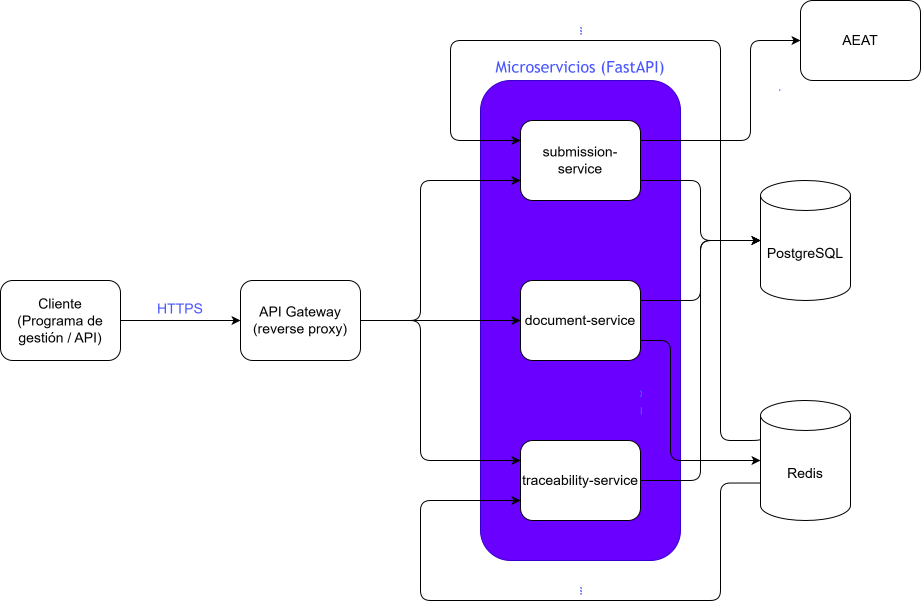

# verifactu-trace

Aplicación nativa de la nube para la emisión y la trazabilidad de facturación electrónica B2B, desarrollada como proyecto de prácticas de la asignatura *Cloud Computing: Fundamentos e Infraestructuras* (Máster en Ingeniería Informática, Universidad de Granada).

[](https://github.com/pablomatgom/verifactu-trace/actions/workflows/ci.yml)
[](https://github.com/pablomatgom/verifactu-trace/actions/workflows/docker.yml)

> **Estado:** Hito 1 completado. Hito 2 (empaquetado cloud native, entorno local e integración continua) completado: los 16 casos de uso están implementados, el sistema completo se levanta con Docker Compose y el CI valida el código y publica las imágenes. Las decisiones del hito están en [`docs/hito2.md`](docs/hito2.md).

## Índice

1. [Descripción del dominio y casos de uso](#descripción-del-dominio-y-casos-de-uso)
2. [Justificación NIST SP 800-145](#justificación-nist-sp-800-145)
3. [Actores NIST SP 500-292](#actores-nist-sp-500-292)
4. [Arquitectura](#arquitectura)
5. [Especificación de la API REST](#especificación-de-la-api-rest)
6. [Desarrollo local](#desarrollo-local)
7. [Integración continua](#integración-continua)
8. [Documentación](#documentación)
9. [Gestión del proyecto](#gestión-del-proyecto)
10. [Licencia](#licencia)

## Descripción del dominio y casos de uso

### Problema

La normativa española de facturación (Reglamento de requisitos de los sistemas informáticos de facturación, conocido como *Verifactu*) exige que el software que emite facturas genere un **registro por cada factura**, que ese registro quede **encadenado criptográficamente** con el anterior para que no pueda alterarse sin dejar rastro, y que pueda **remitirse a la Agencia Tributaria (AEAT)**.

Para una pyme o un despacho profesional esto supone tres problemas operativos:

1. **Emitir correctamente**: aplicar las reglas fiscales (numeración por serie, IVA, retenciones, facturas rectificativas) sin errores.
2. **Garantizar la integridad**: poder demostrar que ninguna factura emitida se ha modificado ni eliminado.
3. **Controlar el envío**: saber en todo momento si cada factura ha llegado a la AEAT, ha sido rechazada o está pendiente de reintento.

`verifactu-trace` es una plataforma de microservicios que cubre este ciclo y mantiene la **trazabilidad completa de cada documento**, desde su emisión hasta su aceptación o rechazo.

### Por qué es un problema para la nube

- **Carga irregular**: la emisión se concentra en cierres de mes y de trimestre, con picos que justifican elasticidad.
- **Disponibilidad**: un fallo del servicio de envío no debe impedir emitir facturas por lo que los envíos se reintentan de forma asíncrona.
- **Servicios independientes**: emisión, trazabilidad y envío tienen necesidades de escalado y fallo diferentes, lo que justifica separarlos.
- **Servicio medido**: el volumen de facturas procesadas es una métrica natural de uso.

### Base conceptual

El proyecto toma como base conceptual mi Trabajo de Fin de Grado, *Arquitectura para la Trazabilidad Documental y Detección de Cuellos de Botella en Redes B2B mediante Grafos y Generación Sintética* (Universidad de Burgos, julio de 2026; [repositorio](https://github.com/pablomatgom/TFG-B2B)). De él se reutiliza únicamente la idea de modelar la trazabilidad como una **cadena de documentos relacionados** (pedido, albarán, factura).

No se copia código del TFG ya que este proyecto resuelve un problema totalmente distinto. Mientras el TFG **analiza** redes B2B con grafos y datos sintéticos, `verifactu-trace` **opera** el ciclo de vida de facturas reales conforme a la normativa, con una arquitectura de microservicios pensada para desplegarse en la nube.

### Casos de uso principales

La cadena documental que se modela es **pedido → albarán → factura**, por lo que cada documento referencia al anterior, de forma que desde una factura se puede reconstruir su origen.

| Código | Caso de uso | Servicio | Prioridad |
|---|---|---|---|
| CU-1 | Registrar un pedido | `document-service` | MVP |
| CU-2 | Registrar un albarán que referencia a un pedido, validando que existe y que las cantidades no lo superan | `document-service` | MVP |
| CU-3 | Emitir una factura (líneas, impuestos y numeración por serie) que referencia a un albarán | `document-service` | MVP |
| CU-4 | Consultar un documento por su identificador | `document-service` | MVP |
| CU-5 | Listar documentos filtrando por tipo, cliente, serie, fechas o estado | `document-service` | MVP |
| CU-6 | Anular un pedido o un albarán que aún no ha sido facturado | `document-service` | Extra |
| CU-7 | Detectar discrepancias de cantidades o importes entre pedido, albarán y factura | `document-service` | Extra |
| CU-8 | Emitir una factura rectificativa que referencia a la factura original | `document-service` | Extra |
| CU-9 | Registrar cada evento de un documento con su hash encadenado | `traceability-service` | MVP |
| CU-10 | Verificar la integridad de la cadena de registros | `traceability-service` | MVP |
| CU-11 | Consultar la cadena documental completa de una factura (pedido → albarán → factura) | `traceability-service` | MVP |
| CU-12 | Consultar el histórico de eventos de un documento (auditoría) | `traceability-service` | MVP |
| CU-13 | Enviar una factura a la AEAT (simulada) con estados y reintentos automáticos | `submission-service` | MVP |
| CU-14 | Consultar el estado de envío de una factura | `submission-service` | MVP |
| CU-15 | Reintentar manualmente un envío fallido o rechazado | `submission-service` | Extra |
| CU-16 | Listar los envíos pendientes o fallidos | `submission-service` | Extra |

### Alcance del producto mínimo viable (MVP)

Incluye el registro de pedidos, albaranes y facturas con validación de sus referencias, el registro encadenado y su verificación, la consulta de la cadena documental y el envío simulado a la AEAT con reintentos. El producto se expone únicamente mediante la **API REST**. Los casos de uso marcados como *Extra* en la tabla anterior forman parte del backlog y se abordan si el tiempo lo permite.

Quedan **fuera** del MVP:

- La firma electrónica real y la integración con los servicios reales de la AEAT.
- La **interfaz web**. No forma parte del MVP, pero se contempla como una posible ampliación futura con un cliente sencillo sobre la API existente para consultar la cadena documental y el estado de envío.

## Justificación NIST SP 800-145

La definición de computación en la nube del NIST (SP 800-145) la caracteriza por cinco características esenciales. A continuación se analiza cómo las aprovecha `verifactu-trace` y qué decisión del proyecto las materializa.

| Característica (NIST) | Definición | Cómo la aprovecha `verifactu-trace` |
|---|---|---|
| **Autoservicio bajo demanda** | El consumidor aprovisiona capacidades de cómputo por sí mismo, sin interacción humana con el proveedor. | Un emisor puede darse de alta y empezar a registrar documentos a través de la API sin intervención de un operador. La infraestructura se describe como código, de modo que el entorno se crea y se destruye de forma automática. |
| **Acceso amplio a la red** | Las capacidades se ofrecen a través de la red mediante mecanismos estándar, para clientes heterogéneos. | Toda la funcionalidad se expone por **API REST sobre HTTP con JSON**, por lo que puede consumirla cualquier software de gestión, un ERP, un script o, en el futuro, una interfaz web. Al ampliarse la base de usuarios potenciales aumenta el riesgo de seguridad, por lo que el acceso se limita a emisores autenticados. |
| **Asignación común de recursos** | Los recursos del proveedor se agrupan para atender a varios consumidores (*multi-tenancy*), asignándose y reasignándose dinámicamente según la demanda. | Los servicios atienden a varios emisores sobre la misma infraestructura, y cada documento queda asociado a su emisor para aislar los datos. La virtualización mediante contenedores permite compartir los recursos del nodo donde se despliegan. |
| **Rápida elasticidad** | Las capacidades se aprovisionan y liberan de forma rápida y automática según la demanda; para el consumidor parecen ilimitadas. | Los picos de emisión de fin de mes o de trimestre se absorben con **escalabilidad horizontal**, añadiendo réplicas de los servicios sin estado y retirándolas cuando baja la demanda. El envío a la AEAT se desacopla mediante una cola, de modo que `submission-service` escala de forma independiente. |
| **Servicio medido** | El uso de recursos se monitoriza, controla y reporta, con transparencia para proveedor y consumidor (pago por uso). | Cada servicio expone métricas de uso (documentos registrados, facturas emitidas, envíos y reintentos, latencias) que sirven tanto para la observabilidad como para calcular el consumo de cada emisor, siguiendo la lógica de *utility computing*. |

*Fuente:* material del Tema 1 de la asignatura.

### Modelo de servicio y de despliegue

- **Modelo de servicio:** el producto se ofrece al consumidor como **SaaS** (una API lista para usarse). Internamente, el despliegue se apoya en un **PaaS o IaaS** del proveedor.
- **Modelo de despliegue:** **nube pública**, aprovechando un proveedor externo.

## Actores NIST SP 500-292

La arquitectura de referencia del NIST (SP 500-292) identifica cinco actores: consumidor, proveedor, intermediario, auditor y operador. En este proyecto hay que distinguir **dos niveles**, porque `verifactu-trace` es a la vez un servicio que se ofrece a emisores de facturas (SaaS) y un cliente de la infraestructura de un proveedor cloud (IaaS o PaaS).

### Mapeo de actores

| Actor (NIST) | Definición | Quién lo es en `verifactu-trace` |
|---|---|---|
| **Consumidor** | Persona u organización que mantiene una relación comercial con los proveedores y utiliza sus recursos. | **Nivel de producto:** las pymes y profesionales que emiten facturas a través de la API, y los programas de gestión que las integran. <br> **Nivel de infraestructura:** el propio proyecto, que consume cómputo y almacenamiento del proveedor cloud. |
| **Proveedor** | Entidad responsable de poner un recurso a disposición de los interesados: gestiona la infraestructura, ejecuta el software y se encarga del acceso a la red. | **Nivel de producto:** el proyecto, que ejecuta los tres microservicios y se responsabiliza de su despliegue, orquestación, gestión, seguridad y privacidad. <br> **Nivel de infraestructura:** el proveedor IaaS o PaaS que se elegirá en el hito 5. |
| **Intermediario** (*broker*) | Entidad que gestiona el uso, el rendimiento y la prestación de recursos, y negocia las relaciones entre proveedores y consumidores. | `submission-service` actúa como intermediario de **intermediación** entre el emisor y la AEAT: añade valor al envío con validación, estados y reintentos. Los programas de gestión o asesorías que integran la API podrían ejercer además de **agregación**. |
| **Auditor** | Entidad que realiza una evaluación independiente de los recursos, las operaciones, el rendimiento y la seguridad. | La **AEAT** y los auditores externos que verifican la integridad de los registros encadenados (CU-10 y CU-12), y quien audite la seguridad y la privacidad del servicio. |
| **Operador** (*carrier*) | Intermediario que proporciona conectividad para los recursos en la nube. | Los operadores de red y la conectividad del proveedor cloud, que permiten al emisor llegar a la API y a la API llegar a la AEAT. |

### Acuerdos de nivel de servicio (SLA)

- **SLA con el consumidor:** el proyecto, como proveedor del producto, define la disponibilidad y los tiempos de respuesta que ofrece a los emisores.
- **SLA con el proveedor cloud:** el proveedor de infraestructura fija la disponibilidad del cómputo y de la red, que condiciona el nivel que el proyecto puede prometer. Normalmente su política de precios y sus SLA no son negociables.

### Impacto económico

| Actor | Impacto económico |
|---|---|
| Consumidor (emisor) | Evita adquirir y mantener un sistema propio de facturación conforme a la normativa, y paga en función del uso. Reduce el riesgo de sanciones por incumplimiento. |
| Proveedor (el proyecto) | Asume el coste de la infraestructura, que escala con la demanda gracias a la elasticidad, y debe compensarlo con el modelo de cobro por uso medido. |
| Proveedor cloud | Ingresa por el consumo de cómputo, almacenamiento y red del proyecto. Para el proyecto es un coste operativo variable en lugar de una inversión inicial. |
| Intermediario | Obtiene valor de la integración y de la reducción de la complejidad que asume el consumidor. |
| Auditor | Su coste se asocia al cumplimiento: disponer de registros verificables reduce el esfuerzo de inspección. |
| Operador | Ingresa por la conectividad, y su calidad condiciona el SLA que el proveedor puede ofrecer. |

*Fuente:* material del Tema 1 de la asignatura.  

## Arquitectura

### Diagrama de referencia



### Componentes

| Componente | Responsabilidad | Persistencia | Casos de uso |
|---|---|---|---|
| `api-gateway` | Punto de entrada único. Enruta las peticiones al servicio correspondiente. | — | Todos |
| `document-service` | Gestiona pedidos, albaranes y facturas, valida sus referencias y la numeración por serie. | PostgreSQL (esquema `documents`) | CU-1 a CU-8 |
| `traceability-service` | Registra los eventos de cada documento con su hash encadenado, verifica la integridad y reconstruye la cadena documental. | PostgreSQL (esquema `traceability`) | CU-9 a CU-12 |
| `submission-service` | Envía las facturas a la AEAT (simulada), controla el estado y reintenta los fallos. | PostgreSQL (esquema `submissions`) | CU-13 a CU-16 |
| PostgreSQL | Base de datos relacional. Una única instancia con un esquema por servicio (`documents`, `traceability` y `submissions`). | — | — |
| Redis | Cola de eventos entre servicios. Desacopla la emisión del registro y del envío. | Streams en memoria | — |
| AEAT simulada | Sustituye al servicio real de la AEAT con respuestas aceptadas, rechazadas o con error transitorio. | — | CU-13 |

### Flujo de emisión de una factura

1. El cliente envía la factura al `document-service` a través del gateway.
2. El `document-service` valida que el albarán referenciado existe, calcula la numeración y los impuestos, y guarda la factura.
3. Publica el evento `invoice.issued` en la cola de Redis y responde al cliente sin esperar al resto.
4. El `traceability-service` consume el evento, calcula el hash encadenado con el registro anterior y lo guarda.
5. El `submission-service` consume el evento, intenta el envío a la AEAT simulada y, si falla, lo reintenta con espera creciente.
6. El cliente consulta la cadena documental en el `traceability-service` o el estado del envío en el `submission-service`.

### Decisiones de diseño

- **Una base de datos lógica por servicio**: cada servicio es el único propietario de su esquema en PostgreSQL y ningún otro accede a él directamente. Se despliega una única instancia para reducir el coste, pero la separación por esquema permite repartirlas en instancias independientes si el escalado lo exige.
- **Comunicación asíncrona mediante eventos**: la emisión no depende de la disponibilidad de la trazabilidad ni del envío. Si la AEAT cae, las facturas se siguen emitiendo y los envíos se reintentan después.
- **Orden de los eventos**: se usan *streams* de Redis, que conservan el orden, algo necesario para encadenar los hashes de cada documento.
- **Servicios sin estado**: ningún servicio guarda estado en memoria, de modo que se pueden replicar tras un balanceador para dar elasticidad en los picos de cierre de mes.
- **Contenedores**: cada componente se empaqueta en su propia imagen Docker, lo que permite desplegarlo en el proveedor cloud que se elija en hitos posteriores.

## Especificación de la API REST

Esta sección define el contrato de la API que expone `verifactu-trace` a través del gateway. Cada servicio generará además su documentación OpenAPI con FastAPI (`/docs`), que se mantendrá alineada con este contrato.

### Convenciones

- **Prefijo y versión**: todas las rutas cuelgan de `/api/v1`. El gateway enruta por el recurso: `/api/v1/documents`, `/api/v1/orders`, `/api/v1/delivery-notes` y `/api/v1/invoices` al `document-service`, `/api/v1/traceability` al `traceability-service` y `/api/v1/submissions` al `submission-service`.
- **Formato**: JSON en UTF-8, fechas en ISO 8601 e importes como números con dos decimales.
- **Identificadores**: UUID asignado por el servidor.
- **Paginación**: los listados admiten `page` y `size` y devuelven `items`, `page`, `size` y `total`.

  ```
  GET /api/v1/documents?type=INVOICE&page=2&size=20
  ```

  ```json
  {
    "items": [ { "id": "5d2e8a6c-...", "type": "INVOICE", "number": "A-2026-000021" } ],
    "page": 2,
    "size": 20,
    "total": 134
  }
  ```

- **Códigos de estado**: `200` consulta, `201` creación, `202` operación aceptada de forma asíncrona, `404` recurso inexistente, `409` conflicto con el estado actual, `422` datos o referencias inválidas.
- **Comprobación de salud**: cada servicio expone `GET /health`, que utilizará la orquestación en hitos posteriores.
- **Errores**: un cuerpo común con el código HTTP correspondiente.

  ```json
  { "error": { "code": "REFERENCE_NOT_FOUND", "message": "El pedido 3f1c... no existe" } }
  ```

### document-service

| Método | Ruta | Descripción | CU | Respuestas |
|---|---|---|---|---|
| `POST` | `/api/v1/orders` | Registra un pedido | CU-1 | `201`, `422` |
| `POST` | `/api/v1/delivery-notes` | Registra un albarán que referencia a un pedido | CU-2 | `201`, `404`, `422` |
| `POST` | `/api/v1/invoices` | Emite una factura que referencia a un albarán | CU-3 | `201`, `404`, `422` |
| `GET` | `/api/v1/documents/{id}` | Consulta un documento por identificador | CU-4 | `200`, `404`, `422` |
| `GET` | `/api/v1/documents` | Lista documentos. Filtros: `type`, `customer`, `series`, `from`, `to`, `status` | CU-5 | `200`, `422` |
| `POST` | `/api/v1/documents/{id}/cancel` | Anula un pedido o albarán no facturado | CU-6 (extra) | `200`, `404`, `409`, `422` |
| `GET` | `/api/v1/documents/{id}/discrepancies` | Detecta diferencias entre pedido, albarán y factura | CU-7 (extra) | `200`, `404`, `422` |
| `POST` | `/api/v1/invoices/{id}/corrections` | Emite una factura rectificativa | CU-8 (extra) | `201`, `404`, `422` |

#### `POST /api/v1/orders` (CU-1)

Registra un pedido. El servidor asigna el `id` (UUID), el número de la serie `P` (`P-<año>-<correlativo de seis cifras>`), la fecha y los importes, y **no se aceptan en la petición**: un campo desconocido se rechaza con `422` en lugar de ignorarse. `vat_rate` es opcional y vale `21` por defecto.

```json
{
  "customer": { "name": "Acme S.L.", "tax_id": "B12345678" },
  "lines": [
    { "description": "Widget", "quantity": 2, "unit_price": 10.5, "vat_rate": 21 }
  ]
}
```

Respuesta `201`:

```json
{
  "id": "62c13d37-67f6-42d1-918e-641e43072aa4",
  "type": "ORDER",
  "number": "P-2026-000001",
  "status": "ISSUED",
  "issue_date": "2026-10-28",
  "customer": { "name": "Acme S.L.", "tax_id": "B12345678" },
  "lines": [
    { "position": 1, "description": "Widget", "quantity": 2.0, "unit_price": 10.5, "vat_rate": 21.0 }
  ],
  "total_net": 21.0,
  "total_vat": 4.41,
  "total": 25.41
}
```

Se responde `422` si el pedido no tiene líneas, si una cantidad no es mayor que cero, si un precio es negativo o tiene más de dos decimales, si el IVA no está entre 0 y 100, si falta un campo obligatorio, si se envía un campo desconocido (como `total`) o si el cuerpo no es un JSON válido. El mensaje indica el campo, o `body` cuando el fallo es del cuerpo entero:

```json
{ "error": { "code": "VALIDATION_ERROR", "message": "lines.0.quantity: Input should be greater than 0" } }
```

#### `POST /api/v1/delivery-notes` (CU-2)

Registra un albarán que referencia a un pedido. Cada línea indica cuánto se entrega de una línea del pedido (`order_line` es su posición, empezando en 1) y no hace falta entregarlas todas. El cliente, las descripciones, los precios y el IVA son los del pedido, y el servidor asigna el `id`, el número de la serie `A` (`A-<año>-<correlativo de seis cifras>`), la fecha y los importes: ninguno se acepta en la petición.

Un pedido puede entregarse en varios albaranes, pero **las cantidades de todos ellos sumadas no pueden superar las pedidas**. Un pedido de 10 unidades admite albaranes de 4 y de 6, pero no de 4 y de 7.

```json
{
  "order_id": "62c13d37-67f6-42d1-918e-641e43072aa4",
  "lines": [
    { "order_line": 1, "quantity": 2 }
  ]
}
```

Respuesta `201`:

```json
{
  "id": "0b6c3d8e-5f0a-4c53-8d5e-9a1d6f2d7c11",
  "type": "DELIVERY_NOTE",
  "number": "A-2026-000001",
  "status": "ISSUED",
  "issue_date": "2026-11-03",
  "order_id": "62c13d37-67f6-42d1-918e-641e43072aa4",
  "customer": { "name": "Acme S.L.", "tax_id": "B12345678" },
  "lines": [
    { "position": 1, "order_line": 1, "description": "Widget", "quantity": 2.0, "unit_price": 10.5, "vat_rate": 21.0 }
  ],
  "total_net": 21.0,
  "total_vat": 4.41,
  "total": 25.41
}
```

Los errores usan el cuerpo común `{"error": {"code": "...", "message": "..."}}`:

| Respuesta | Código | Cuándo |
|---|---|---|
| `404` | `REFERENCE_NOT_FOUND` | El pedido no existe, o el identificador es de un documento que no es un pedido |
| `422` | `INVALID_ORDER_LINE` | `order_line` no es una línea del pedido |
| `422` | `QUANTITY_EXCEEDED` | Lo entregado, sumando los albaranes anteriores, supera lo pedido. Los albaranes anulados no cuentan |
| `422` | `REFERENCE_CANCELLED` | El pedido está anulado (CU-6) |
| `422` | `VALIDATION_ERROR` | Cuerpo mal formado: cantidad no mayor que cero, sin líneas, una línea del pedido repetida, falta un campo o hay uno desconocido |

```json
{ "error": { "code": "QUANTITY_EXCEEDED", "message": "line 1: 7 requested but only 6 pending (ordered 10, already delivered 4)" } }
```

Dos albaranes simultáneos del mismo pedido no pueden superar entre los dos lo pedido: el servidor bloquea el pedido mientras comprueba las cantidades y guarda el albarán.

#### `POST /api/v1/invoices` (CU-3)

Emite la factura de un albarán. Solo se envía el albarán: la factura **factura lo que el albarán entregó**, con el cliente y los precios del pedido. El servidor asigna el `id`, el número de la serie `F` (`F-<año>-<correlativo de seis cifras>`, sin huecos), la fecha y los importes: ninguno se acepta en la petición, y un campo desconocido se rechaza con `422`.

Un albarán solo se puede facturar una vez.

```json
{ "delivery_note_id": "0b6c3d8e-5f0a-4c53-8d5e-9a1d6f2d7c11" }
```

Respuesta `201`:

```json
{
  "id": "5d2e8a6c-1f40-4b9a-9c77-3e0a6b4d1f52",
  "type": "INVOICE",
  "number": "F-2026-000001",
  "status": "ISSUED",
  "issue_date": "2026-11-03",
  "delivery_note_id": "0b6c3d8e-5f0a-4c53-8d5e-9a1d6f2d7c11",
  "order_id": "62c13d37-67f6-42d1-918e-641e43072aa4",
  "customer": { "name": "Acme S.L.", "tax_id": "B12345678" },
  "lines": [
    { "position": 1, "delivery_note_line": 1, "description": "Widget", "quantity": 2.0, "unit_price": 10.5, "vat_rate": 21.0 }
  ],
  "total_net": 21.0,
  "total_vat": 4.41,
  "total": 25.41
}
```

`total_net` es la base imponible, `total_vat` la cuota de IVA y `total` la suma de ambas. La cadena queda enlazada: la factura apunta a su albarán (`delivery_note_id`) y cada línea a la línea del albarán que factura (`delivery_note_line`).

| Respuesta | Código | Cuándo |
|---|---|---|
| `404` | `REFERENCE_NOT_FOUND` | El albarán no existe, o el identificador es de un documento que no es un albarán |
| `422` | `DELIVERY_NOTE_ALREADY_INVOICED` | El albarán ya tiene factura |
| `422` | `REFERENCE_CANCELLED` | El albarán está anulado (CU-6) |
| `422` | `VALIDATION_ERROR` | Cuerpo mal formado: falta `delivery_note_id`, no es un UUID o hay un campo desconocido |

Dos peticiones simultáneas para el mismo albarán no pueden emitir dos facturas: el servidor bloquea el albarán mientras comprueba y guarda, y la base de datos lo impide además con un índice único.

**Evento `invoice.issued`.** Cuando la factura queda guardada, el servicio publica el evento en el *stream* de Redis `invoice.issued`, del que leerán `traceability-service` y `submission-service`. Cada entrada lleva estos campos, todos texto:

| Campo | Contenido |
|---|---|
| `invoice_id` | Identificador de la factura |
| `number` | Número de la factura, como `F-2026-000001` |
| `delivery_note_id` | Identificador del albarán facturado |
| `order_id` | Identificador del pedido de origen |
| `total` | Total de la factura, como `25.41`. Negativo en una rectificativa (CU-8) |
| `issued_at` | Fecha y hora de emisión, en ISO 8601 con zona horaria |

Una factura rectificativa (CU-8) publica el mismo evento: `invoice_id` y `number` son los suyos, y `delivery_note_id` y `order_id` los de la factura que rectifica. El evento se publica **después de guardar** la factura. Si Redis no responde, la factura se emite igual (`201`) y el fallo queda en el log, porque un servicio que reacciona a las facturas no debe impedir emitirlas. Eso significa que el evento se puede perder; ver las limitaciones en [`docs/arquitectura.md`](docs/arquitectura.md).

#### `POST /api/v1/invoices/{id}/corrections` (CU-8)

Emite una factura **rectificativa**: corrige una factura ya emitida sin modificarla. `{id}` es el de la factura que se rectifica.

```json
{
  "reason": "Se devolvieron dos unidades dañadas",
  "lines": [ { "invoice_line": 1, "quantity": 2 } ]
}
```

`reason` es el motivo (obligatorio, hasta 300 caracteres). `lines` dice cuánto se devuelve de cada línea de la factura (`invoice_line` es su posición, desde 1) y es **opcional**: si se omite, se devuelve todo lo que aún no se había rectificado. Una línea se puede dejar fuera, pero no repetir. Las cantidades se envían en positivo, hasta con 3 decimales.

Responde `201` con la rectificativa, con su propio número de la **serie `R`** (`R-2026-000001`) y la referencia a la factura original en `corrects_invoice_id`:

```json
{
  "id": "c411a3b4-3768-432b-9724-c8300f73bf60",
  "type": "CORRECTIVE_INVOICE",
  "number": "R-2026-000001",
  "status": "ISSUED",
  "issue_date": "2026-11-08",
  "corrects_invoice_id": "5d2e8a6c-1f40-4b9a-9c77-3e0a6b4d1f52",
  "reason": "Se devolvieron dos unidades dañadas",
  "customer": { "name": "Acme S.L.", "tax_id": "B12345678" },
  "lines": [
    { "position": 1, "invoice_line": 1, "description": "Widget", "quantity": -2.0, "unit_price": 10.5, "vat_rate": 21.0 }
  ],
  "total_net": -21.0,
  "total_vat": -4.41,
  "total": -25.41
}
```

- **Cantidades y totales negativos.** La rectificativa devuelve unidades, así que sus líneas tienen cantidad negativa, al precio y con el IVA de la factura original, y sus importes salen negativos con el mismo redondeo que cualquier factura. Con `lines` omitido, anula exactamente los importes de la factura original, con el signo cambiado.
- **La factura original no se toca.** La rectificativa es un documento aparte (`type` `CORRECTIVE_INVOICE`) cuyo `parent_id` es la factura. Se lee con `GET /api/v1/documents/{id}` como cualquier otro, y aparece en el listado con `type=CORRECTIVE_INVOICE` o `series=R`.
- **Varias rectificativas.** Una factura puede tener varias, pero entre todas no pueden devolver más de lo facturado en cada línea: se lleva la cuenta de lo ya rectificado. Dos peticiones a la vez no pueden pasarse del total, porque el servidor bloquea la factura mientras comprueba y guarda.
- **Es una factura más.** Al guardarla se publica el evento `invoice.issued`, igual que para cualquier factura, así que se encadena en `traceability-service` y se envía a la AEAT desde `submission-service`. Sus campos `delivery_note_id` y `order_id` son los de la factura original, y `total` es negativo. No se puede anular.
- **Qué corrige y qué no.** Solo corrige **cantidades** (devoluciones o abonos). No cambia precios ni IVA: para eso habría que devolver la línea y facturarla de nuevo, algo que esta API no permite porque un albarán solo se factura una vez. Es una limitación conocida.

| Respuesta | Código | Cuándo |
|---|---|---|
| `404` | `REFERENCE_NOT_FOUND` | La factura no existe, o el identificador es de un documento que no es una factura (un pedido, un albarán o una rectificativa) |
| `422` | `INVALID_INVOICE_LINE` | `invoice_line` no es una línea de la factura |
| `422` | `QUANTITY_EXCEEDED` | Lo devuelto, sumando las rectificativas anteriores, supera lo facturado |
| `422` | `NOTHING_TO_CORRECT` | `lines` se omitió y la factura ya está rectificada por completo |
| `422` | `VALIDATION_ERROR` | Falta `reason` o está vacío o es demasiado largo, `lines` está vacío o repite una línea, una cantidad no es mayor que cero o tiene más de 3 decimales, o hay un campo desconocido |

#### `GET /api/v1/documents/{id}` (CU-4)

Consulta un pedido, un albarán o una factura por su identificador. Los tres tipos se devuelven con **la misma forma**, y `type` indica de cuál se trata (`ORDER`, `DELIVERY_NOTE`, `INVOICE` o `CORRECTIVE_INVOICE`). La consulta no modifica nada.

Respuesta `200` (un albarán):

```json
{
  "id": "0b6c3d8e-5f0a-4c53-8d5e-9a1d6f2d7c11",
  "type": "DELIVERY_NOTE",
  "number": "A-2026-000001",
  "status": "ISSUED",
  "issue_date": "2026-11-02",
  "parent_id": "62c13d37-67f6-42d1-918e-641e43072aa4",
  "customer": { "name": "Acme S.L.", "tax_id": "B12345678" },
  "lines": [
    { "position": 1, "source_line": 1, "description": "Widget", "quantity": 2.0, "unit_price": 10.5, "vat_rate": 21.0 }
  ],
  "total_net": 21.0,
  "total_vat": 4.41,
  "total": 25.41
}
```

La cadena documental se recorre con dos campos. `parent_id` es el documento anterior de la cadena: el pedido de un albarán y el albarán de una factura (en un pedido vale `null`). `source_line` es la posición de la línea del documento anterior de la que viene cada línea: la del pedido que entrega una línea de albarán, la del albarán que factura una línea de factura (en un pedido vale `null`). Con ellos un cliente puede ir de una factura a su pedido consultando cada `parent_id`.

| Respuesta | Código | Cuándo |
|---|---|---|
| `404` | `DOCUMENT_NOT_FOUND` | No existe ningún documento con ese identificador |
| `422` | `VALIDATION_ERROR` | El identificador no es un UUID |

Las respuestas de creación (`POST /orders`, `/delivery-notes` y `/invoices`) conservan su forma, con campos propios de cada tipo (`order_id`, `delivery_note_id`...). Esta consulta usa la forma común para los tres.

#### `GET /api/v1/documents` (CU-5)

Lista pedidos, albaranes y facturas. Todos los parámetros son opcionales y **los filtros se suman**: un documento tiene que cumplirlos todos.

| Parámetro | Filtra por |
|---|---|
| `type` | Tipo: `ORDER`, `DELIVERY_NOTE`, `INVOICE` o `CORRECTIVE_INVOICE` |
| `customer` | Cliente: el texto es su NIF/CIF exacto, o parte de su nombre (sin distinguir mayúsculas) |
| `series` | Serie: `P`, `A`, `F` o `R` |
| `status` | Estado: `ISSUED` o `CANCELLED` |
| `from`, `to` | Fecha de emisión, desde `from` hasta `to`, **ambas incluidas** |
| `page` | Número de página, desde 1 (por defecto `1`) |
| `size` | Documentos por página, de 1 a 100 (por defecto `20`) |

```
GET /api/v1/documents?type=INVOICE&customer=acme&from=2026-11-01&page=1&size=2
```

Respuesta `200`, con los documentos más recientes primero. Cada elemento lleva la cabecera y los importes del documento, sin las líneas (para ver una factura entera se usa `GET /api/v1/documents/{id}`):

```json
{
  "items": [
    {
      "id": "5d2e8a6c-1f40-4b9a-9c77-3e0a6b4d1f52",
      "type": "INVOICE",
      "number": "F-2026-000002",
      "status": "ISSUED",
      "issue_date": "2026-11-05",
      "parent_id": "0b6c3d8e-5f0a-4c53-8d5e-9a1d6f2d7c11",
      "customer": { "name": "Acme S.L.", "tax_id": "B12345678" },
      "total_net": 21.0,
      "total_vat": 4.41,
      "total": 25.41
    }
  ],
  "page": 1,
  "size": 2,
  "total": 134
}
```

`total` es el número de documentos que cumplen los filtros en **todas** las páginas, no solo en esta: con él un cliente sabe cuántas páginas hay (`ceil(total / size)`). Una página más allá de la última devuelve `items` vacío y conserva el `total`. Si ningún documento cumple los filtros, la respuesta es `200` con `items` vacío y `total` a `0`, no un `404`.

Los documentos se ordenan por fecha de emisión descendente y, dentro del mismo día, por número descendente. El orden es siempre el mismo, así que un documento no aparece en dos páginas ni se salta mientras el cliente las recorre.

| Respuesta | Código | Cuándo |
|---|---|---|
| `422` | `VALIDATION_ERROR` | Un parámetro no es válido: `type` o `status` desconocidos, una fecha mal formada, `page` menor que 1 o `size` fuera de 1 a 100 |
| `422` | `INVALID_DATE_RANGE` | `from` es posterior a `to` |

#### `POST /api/v1/documents/{id}/cancel` (CU-6)

Anula un pedido o un albarán, para corregir un error. No lleva cuerpo. El documento **no se borra**: se conserva con `status` `CANCELLED`, con su número, y la respuesta es el documento entero, igual que `GET /api/v1/documents/{id}`.

Un documento anulado no se puede volver a usar: no se pueden hacer albaranes de un pedido anulado ni facturas de un albarán anulado (`422` `REFERENCE_CANCELLED`). Anular un albarán **libera las cantidades** que entregaba, que se pueden volver a entregar. Y el número de un documento anulado no se reutiliza, como corresponde a una numeración fiscal.

Qué se puede anular:

| Documento | Se puede anular si… |
|---|---|
| Pedido | No tiene albaranes, o todos están anulados. Si tuviera alguno vivo, quedaría sin pedido: se anulan antes |
| Albarán | No tiene factura |
| Factura | **Nunca**: una factura emitida no se anula, solo se rectifica (CU-8). Una rectificativa tampoco |

Un documento que ya está anulado tampoco se puede anular otra vez.

| Respuesta | Código | Cuándo |
|---|---|---|
| `200` | — | El documento queda `CANCELLED` |
| `404` | `DOCUMENT_NOT_FOUND` | No existe un documento con ese id |
| `409` | `DOCUMENT_NOT_CANCELLABLE` | Es una factura, ya está anulado, es un albarán con factura o es un pedido con albaranes sin anular. El mensaje dice el motivo |
| `422` | `VALIDATION_ERROR` | El id no es un UUID |

```json
{ "error": { "code": "DOCUMENT_NOT_CANCELLABLE", "message": "order P-2026-000007 has delivery notes that are not cancelled (A-2026-000006): cancel them first" } }
```

Una anulación y una petición que se apoya en el mismo documento (un albarán de ese pedido, una factura de ese albarán) a la vez no se pisan: la anulación bloquea el documento, y la otra petición espera y ve su resultado. O la anulación va primero y la otra se rechaza con `REFERENCE_CANCELLED`, o va después y se rechaza la anulación.

La anulación **no publica ningún evento**: `traceability-service` solo registra las facturas, y estas no se pueden anular.

#### `GET /api/v1/documents/{id}/discrepancies` (CU-7)

Compara, línea a línea, los documentos de la cadena de `{id}` para detectar diferencias antes de que lleguen a la contabilidad. La consulta no modifica nada.

La cadena es la del documento por el que se pregunta, desde su pedido hasta él mismo: con el id de una **factura** se comparan el pedido, el albarán y la factura; con el de un albarán, el pedido y el albarán; y con el de un pedido no hay nada con lo que compararlo.

```json
{
  "document_id": "5d2e8a6c-1f40-4b9a-9c77-3e0a6b4d1f52",
  "compared": [
    { "type": "ORDER", "id": "3f1c0b7a-...", "number": "P-2026-000008" },
    { "type": "DELIVERY_NOTE", "id": "9a7b2d1e-...", "number": "A-2026-000008" },
    { "type": "INVOICE", "id": "5d2e8a6c-...", "number": "F-2026-000006" }
  ],
  "discrepancies": [
    {
      "field": "quantity",
      "description": "Widget",
      "source": { "document_type": "ORDER", "number": "P-2026-000008", "line": 1, "value": 10.0 },
      "target": { "document_type": "DELIVERY_NOTE", "number": "A-2026-000008", "line": 1, "value": 4.0 }
    }
  ]
}
```

Cada documento se compara con el **siguiente** de la cadena (pedido con albarán, albarán con factura). Cada línea se busca en el documento siguiente a través de `source_line`, que es como una línea dice de cuál viene, y han de coincidir tres campos: `quantity`, `unit_price` y `vat_rate`. Cada diferencia dice cuál es el campo, qué línea es y el valor en cada lado (`source` es el documento anterior, `target` el posterior). Una línea del documento anterior que el siguiente no tiene cuenta como cantidad `0`, con `line` a `null` en `target`. Las líneas del documento posterior que no vienen de ninguna del anterior no se comparan. Una factura rectificativa (CU-8) tampoco se compara con la factura que rectifica, porque difiere de ella a propósito. Una cadena coherente devuelve `discrepancies` vacío.

**Una entrega parcial es una diferencia.** Si el pedido era de 10 y el albarán entrega 4, aparece como diferencia de `quantity`. No tiene por qué ser un error (el resto se puede entregar en otro albarán), pero sí es una diferencia entre los documentos, y cada albarán se compara con el pedido por separado. Una cadena creada con esta API solo puede tener diferencias de ese tipo, porque el albarán copia el precio y el IVA del pedido y la factura copia lo que entregó el albarán. El resto de diferencias aparecen si algo modifica un documento después (un fallo o una escritura directa en la base de datos), que es lo que esta consulta detecta.

| Respuesta | Código | Cuándo |
|---|---|---|
| `404` | `DOCUMENT_NOT_FOUND` | No existe un documento con ese id |
| `422` | `VALIDATION_ERROR` | El id no es un UUID |

### traceability-service

| Método | Ruta | Descripción | CU | Respuestas |
|---|---|---|---|---|
| `POST` | `/api/v1/traceability/events` | Registra un evento con su hash encadenado. **Interno**: se alimenta de la cola y no se publica en el gateway | CU-9 | `201`, `422` |
| `GET` | `/api/v1/traceability/documents/{id}/verification` | Verifica la integridad de la cadena de registros | CU-10 | `200`, `404`, `422` |
| `GET` | `/api/v1/traceability/documents/{id}/chain` | Devuelve la cadena documental (pedido → albarán → factura) | CU-11 | `200`, `404`, `422`, `502`, `503` |
| `GET` | `/api/v1/traceability/documents/{id}/events` | Devuelve el histórico de eventos de un documento | CU-12 | `200`, `404`, `422` |

#### `POST /api/v1/traceability/events` (CU-9)

Registra un evento al final de la cadena de su documento. Es un endpoint **interno**: los eventos llegan normalmente desde el *stream* `invoice.issued` (ver más abajo), y este endpoint permite registrar otros a mano.

```json
{
  "document_id": "5d2e8a6c-1f40-4b9a-9c77-3e0a6b4d1f52",
  "event_type": "INVOICE_ISSUED",
  "occurred_at": "2026-10-14T09:30:00Z",
  "payload": { "number": "F-2026-000001", "total": "380.82" }
}
```

Solo `document_id` y `event_type` son obligatorios. `occurred_at` (con zona horaria) vale por defecto la hora del servidor y `payload` es `{}`. El servidor asigna el resto:

```json
{
  "id": "c04a8625-30b9-424d-8301-8d6185bcda4d",
  "document_id": "5d2e8a6c-1f40-4b9a-9c77-3e0a6b4d1f52",
  "sequence": 1,
  "event_type": "INVOICE_ISSUED",
  "occurred_at": "2026-10-14T09:30:00Z",
  "payload": { "number": "F-2026-000001", "total": "380.82" },
  "previous_hash": "0000000000000000000000000000000000000000000000000000000000000000",
  "hash": "0741fde33e4ee2990368a1ba86008a3ac66769e9e978b077905a9605369a4225"
}
```

| Código | `error.code` | Cuándo |
|---|---|---|
| `422` | `VALIDATION_ERROR` | Falta `document_id` o `event_type`, no es un UUID, `occurred_at` no tiene zona horaria, o hay un campo desconocido (por ejemplo `hash` o `sequence`, que calcula el servidor) |

**Cadena de hashes.** Cada documento tiene su propia cadena:

- `sequence` cuenta desde 1 para cada documento.
- `previous_hash` es el `hash` del evento anterior del mismo documento. El primero usa un hash inicial de 64 ceros.
- `hash` es el SHA-256 del contenido canónico del evento seguido de `previous_hash`. El contenido canónico es un JSON con las claves ordenadas y sin espacios (`document_id`, `event_type`, `occurred_at` en UTC, `payload` y `sequence`), de modo que se puede recalcular más tarde para verificar la cadena (CU-10).
- Dos eventos del mismo documento que llegan a la vez se encadenan uno detrás de otro, en el orden en que obtienen el bloqueo de la cadena. Nunca se bifurca.

**Consumo del evento `invoice.issued`.** Al arrancar, `traceability-service` lee el *stream* `invoice.issued` con un grupo de consumidores (`traceability-service`) y registra cada factura como un evento `INVOICE_ISSUED` en la cadena de la factura. El `payload` lleva `number`, `delivery_note_id`, `order_id`, `total` e `issued_at`, y `occurred_at` es `issued_at`.

- Confirma (`XACK`) cada entrada **después de guardar** el evento. Si el servicio cae o la base de datos no responde, la entrada queda pendiente y se entrega de nuevo, así que no se pierde por este lado.
- Si una entrada se entrega dos veces, el evento no se duplica: guarda el identificador de la entrada (`source_message_id`) y lo reconoce.
- Si el servicio estuvo parado, registra al volver las facturas emitidas mientras tanto, porque el grupo empieza en el principio del *stream*.
- Una entrada mal formada (sin campos o con valores ilegibles) se descarta con un error en el log para no bloquear las siguientes.

#### `GET /api/v1/traceability/documents/{id}/verification` (CU-10)

Verifica que nadie ha manipulado los eventos de un documento. Recalcula la cadena de hashes **en orden, desde el primer evento**, y la compara con lo que hay guardado. La consulta no modifica nada.

Respuesta `200` con la cadena intacta:

```json
{
  "document_id": "5d2e8a6c-1f40-4b9a-9c77-3e0a6b4d1f52",
  "valid": true,
  "events_checked": 3,
  "first_invalid_sequence": null
}
```

Con un evento alterado, `valid` es `false` e indica dónde se rompe la cadena:

```json
{
  "document_id": "5d2e8a6c-1f40-4b9a-9c77-3e0a6b4d1f52",
  "valid": false,
  "events_checked": 3,
  "first_invalid_sequence": 2
}
```

Un evento falla si no cumple alguna de estas tres comprobaciones:

1. **Su `sequence` es la que sigue al evento anterior** (el primero, 1). Detecta un evento borrado de la mitad aunque se hayan recalculado los hashes de los siguientes.
2. **Su `previous_hash` es el `hash` guardado del evento anterior** (el primero, 64 ceros). Detecta un evento sustituido: el siguiente seguía encadenado al original.
3. **Su `hash` coincide con el SHA-256 recalculado** del contenido del evento y su `previous_hash`. Detecta que se cambiaron sus datos (`event_type`, `occurred_at` o `payload`) o el propio `hash`.

`first_invalid_sequence` es la `sequence` del **primer** evento que falla. Los siguientes no se señalan, porque dejan de ser fiables en cuanto se rompe un eslabón. Cada evento se compara con el hash *guardado* de su vecino, no con uno recalculado, así que un evento alterado se señala en su propia posición y no en la siguiente. Si se borra un evento de la mitad, se señala el que venía detrás. `events_checked` es el número de eventos de la cadena del documento.

| Respuesta | Código | Cuándo |
|---|---|---|
| `404` | `EVENTS_NOT_FOUND` | El documento no tiene ningún evento |
| `422` | `VALIDATION_ERROR` | El identificador no es un UUID |

**Qué no detecta.** La cadena detecta manipulaciones, no las impide: la base de datos acepta un `UPDATE`, y la verificación lo descubre después. Tampoco puede detectar que se **borren los últimos eventos**, ni que se **reescriba el último** recalculando su hash, porque ningún evento posterior responde por ellos. Para eso haría falta guardar el último hash fuera de esta base de datos (en un servicio externo, o publicado). Está en las limitaciones de [`docs/arquitectura.md`](docs/arquitectura.md).

#### `GET /api/v1/traceability/documents/{id}/chain` (CU-11)

Devuelve los documentos que respaldan una factura, en el orden en que se hicieron: el pedido, el albarán y la factura. `{id}` es el de la **factura**.

```json
{
  "invoice_id": "5d2e8a6c-1f40-4b9a-9c77-3e0a6b4d1f52",
  "chain": [
    { "type": "ORDER", "id": "3f1c0b7a-...", "number": "P-2026-000001", "issue_date": "2026-10-10" },
    { "type": "DELIVERY_NOTE", "id": "9a7b2d1e-...", "number": "A-2026-000001", "issue_date": "2026-10-12" },
    { "type": "INVOICE", "id": "5d2e8a6c-...", "number": "F-2026-000001", "issue_date": "2026-10-14" }
  ]
}
```

Este servicio no guarda los documentos, solo sus eventos. Por eso reconstruye la cadena **a partir de las referencias** que guarda `document-service`: pide la factura, sigue su `parent_id` hasta el albarán, y el de este hasta el pedido (ver `GET /api/v1/documents/{id}`). La dirección de `document-service` se pasa en la variable `DOCUMENT_SERVICE_URL`, que `compose.yaml` ya define. A diferencia de CU-9, CU-10 y CU-12, esta consulta **depende de que `document-service` esté en marcha**.

| Respuesta | Código | Cuándo |
|---|---|---|
| `404` | `INVOICE_NOT_FOUND` | No existe una factura con ese id. También si el id es el de un pedido o un albarán |
| `422` | `VALIDATION_ERROR` | El identificador no es un UUID |
| `502` | `INCONSISTENT_CHAIN` | `document-service` devuelve documentos que no forman la cadena factura → albarán → pedido. No debería ocurrir mientras se respeten las referencias |
| `503` | `DOCUMENT_SERVICE_UNAVAILABLE` | `document-service` no responde (3 segundos de espera como máximo) o devuelve un error |

#### `GET /api/v1/traceability/documents/{id}/events` (CU-12)

Devuelve el histórico de eventos de un documento, para auditar qué le ha ocurrido y cuándo. Los eventos vienen **ordenados por `sequence`**, es decir, en el orden en que se registraron, que es el de su cadena de hashes. La consulta no modifica nada.

Respuesta `200`:

```json
{
  "document_id": "5d2e8a6c-1f40-4b9a-9c77-3e0a6b4d1f52",
  "events": [
    {
      "id": "c04a8625-30b9-424d-8301-8d6185bcda4d",
      "document_id": "5d2e8a6c-1f40-4b9a-9c77-3e0a6b4d1f52",
      "sequence": 1,
      "event_type": "INVOICE_ISSUED",
      "occurred_at": "2026-10-14T09:30:00Z",
      "payload": { "number": "F-2026-000001", "total": "380.82" },
      "previous_hash": "0000000000000000000000000000000000000000000000000000000000000000",
      "hash": "0741fde33e4ee2990368a1ba86008a3ac66769e9e978b077905a9605369a4225"
    }
  ]
}
```

Cada evento tiene la misma forma que la respuesta de `POST /api/v1/traceability/events`, con sus dos hashes, así que quien audita puede comprobar que cada `previous_hash` es el `hash` del evento anterior. El orden es el de `sequence` y no el de `occurred_at`: un evento puede decir que ocurrió antes que otro que se registró antes. La lista no está paginada, porque la cadena de un documento tiene pocos eventos.

| Respuesta | Código | Cuándo |
|---|---|---|
| `404` | `EVENTS_NOT_FOUND` | El documento no tiene ningún evento |
| `422` | `VALIDATION_ERROR` | El identificador no es un UUID |

Un documento que no existe y uno al que todavía no le ha ocurrido nada responden lo mismo (`404`). `traceability-service` no guarda los documentos, solo los eventos que se refieren a ellos, así que no puede distinguirlos. Un documento recién creado, por ejemplo un pedido o un albarán, no tiene eventos hasta que se registra uno: de momento solo las facturas generan el evento `INVOICE_ISSUED`.

### submission-service

| Método | Ruta | Descripción | CU | Respuestas |
|---|---|---|---|---|
| `POST` | `/api/v1/submissions` | Solicita el envío de una factura a la AEAT simulada | CU-13 | `202`, `409`, `422` |
| `GET` | `/api/v1/submissions/{id}` | Consulta el estado de un envío | CU-14 | `200`, `404`, `422` |
| `GET` | `/api/v1/submissions` | Lista envíos paginados. Filtros: `invoice_id`, `status` | CU-14, CU-16 (extra) | `200`, `422` |
| `POST` | `/api/v1/submissions/{id}/retry` | Reintenta manualmente un envío fallido o rechazado | CU-15 (extra) | `202`, `404`, `409`, `422` |

Normalmente el envío se dispara solo al recibir el evento `invoice.issued`. `POST /api/v1/submissions` permite lanzarlo manualmente.

#### `POST /api/v1/submissions` (CU-13)

Pide el envío de una factura a la AEAT simulada. Solo lleva el identificador de la factura:

```json
{ "invoice_id": "5d2e8a6c-1f40-4b9a-9c77-3e0a6b4d1f52" }
```

Responde `202` porque la factura **todavía no se ha enviado**: el envío queda registrado como `PENDING` y un proceso en segundo plano lo envía y lo reintenta.

```json
{
  "id": "c8f4a1d0-7e22-4b0c-9d51-6a3e8f2b1c04",
  "invoice_id": "5d2e8a6c-1f40-4b9a-9c77-3e0a6b4d1f52",
  "invoice_number": null,
  "status": "PENDING",
  "attempts": 0,
  "next_attempt_at": "2026-10-14T09:30:00.123456Z",
  "last_error": null,
  "aeat_reference": null
}
```

| Código | `error.code` | Cuándo |
|---|---|---|
| `409` | `SUBMISSION_ALREADY_EXISTS` | La factura ya tiene un envío (porque llegó su evento o porque ya se pidió a mano) |
| `422` | `VALIDATION_ERROR` | Falta `invoice_id`, no es un UUID o hay un campo desconocido |

El servicio **no comprueba que la factura exista**, porque las facturas pertenecen a `document-service`. Podría hacerlo con la consulta de documentos (CU-4), pero acoplaría los dos servicios: el envío dejaría de funcionar si el otro cae. Es la razón de que este endpoint no responda `404`.

**Envío automático.** Al arrancar, el servicio lee el *stream* `invoice.issued` con su propio grupo de consumidores (`submission-service`, distinto del de trazabilidad, así que los dos reciben cada factura) y registra un envío `PENDING` por cada una. Funciona igual que el consumidor de trazabilidad: confirma cada entrada después de guardar, la reintenta si el servicio cae y descarta las entradas mal formadas. Una factura solo tiene **un envío**, así que si su evento llega dos veces, o ya se pidió a mano, no se crea otro.

**Estados y reintentos.** Un segundo proceso en segundo plano busca cada segundo los envíos que toca intentar y los manda a la AEAT:

```
PENDING ──► SENT ──► ACCEPTED
              │ └──► REJECTED                (la AEAT lo rechaza: es definitivo)
              └────► RETRYING ──► SENT ...   (la AEAT no responde: se reintenta)
                        └──────► FAILED      (se agotaron los intentos: es definitivo)
```

- `SENT` significa que hay un intento en curso. Cada intento incrementa `attempts`.
- Si la AEAT no responde, el envío pasa a `RETRYING` y se reintenta con una **espera creciente**: el doble tras cada fallo (5, 10, 20, 40 segundos con los valores por defecto, con un máximo de una hora). Tras el último intento fallido pasa a `FAILED`. El último error queda en `last_error`.
- Si la AEAT rechaza la factura, no se reintenta solo: enviarla otra vez daría la misma respuesta. Una vez corregido el motivo, un `REJECTED` o un `FAILED` se puede reenviar a mano (CU-15).
- Los reintentos se guardan en la base de datos (`next_attempt_at`), no en memoria, así que sobreviven a un reinicio y cualquier réplica puede hacerlos. Un envío que lleva un minuto en `SENT` sin respuesta (el servicio cayó mientras lo enviaba) se da por perdido y se vuelve a enviar.

**AEAT simulada.** El servicio habla con la AEAT a través de una interfaz (`AeatClient`), y la implementación actual es una simulación dentro del propio servicio. Se elige con variables de entorno, que `compose.yaml` pasa al contenedor (se cambian en `.env`):

| Variable | Valor por defecto | Efecto |
|---|---|---|
| `AEAT_SIMULATION` | `accept` | `accept`: acepta todos los envíos. `reject`: los rechaza. `fail`: no responde nunca, así que acaban en `FAILED`. `flaky`: cada intento falla con la probabilidad de `AEAT_FAILURE_RATE` y si no, lo acepta |
| `AEAT_FAILURE_RATE` | `0.5` | Probabilidad de fallo con `flaky` (de 0 a 1) |
| `SUBMISSION_MAX_ATTEMPTS` | `5` | Intentos antes de pasar a `FAILED` |
| `SUBMISSION_RETRY_BASE_SECONDS` | `5` | Espera tras el primer fallo; se duplica después |

Para ver los reintentos, por ejemplo, con `AEAT_SIMULATION=flaky` en `.env`, `docker compose up -d submission-service` y emitir facturas. El estado se consulta con `GET /api/v1/submissions/{id}` o `GET /api/v1/submissions?invoice_id=` (CU-14).

#### `GET /api/v1/submissions/{id}` (CU-14)

Consulta dónde está el envío de una factura. Devuelve el mismo cuerpo de envío que el `POST`:

```json
{
  "id": "c8f4a1d0-7e22-4b0c-9d51-6a3e8f2b1c04",
  "invoice_id": "5d2e8a6c-1f40-4b9a-9c77-3e0a6b4d1f52",
  "invoice_number": "F-2026-000001",
  "status": "RETRYING",
  "attempts": 2,
  "next_attempt_at": "2026-10-14T09:34:00Z",
  "last_error": "AEAT_UNAVAILABLE",
  "aeat_reference": null
}
```

Para saber si una factura llegó a la AEAT, mira `status`: `ACCEPTED` o `REJECTED` son definitivos, `PENDING`, `SENT` y `RETRYING` están en marcha (`next_attempt_at` dice cuándo se intenta de nuevo) y `FAILED` se rindió tras agotar los intentos. `last_error` guarda el motivo del último fallo o rechazo.

Para buscar el envío de una **factura** sin conocer el id del envío se usa el listado con `invoice_id` (ver CU-16). Como una factura tiene un solo envío, trae un elemento o ninguno: una factura sin envío, o que no existe, recibe `"items": []` y no un `404`.

| Respuesta | Código | Cuándo |
|---|---|---|
| `404` | `SUBMISSION_NOT_FOUND` | No existe un envío con ese id |
| `422` | `VALIDATION_ERROR` | El id no es un UUID |

#### `GET /api/v1/submissions` (CU-16)

Lista los envíos, por ejemplo los pendientes o fallidos para actuar sobre las facturas que no han llegado a la AEAT. Todos los parámetros son opcionales y **los filtros se suman**.

| Parámetro | Filtra por |
|---|---|
| `invoice_id` | La factura: devuelve su envío, si lo tiene |
| `status` | Estado: `PENDING`, `SENT`, `ACCEPTED`, `REJECTED`, `RETRYING` o `FAILED` |
| `page` | Número de página, desde 1 (por defecto `1`) |
| `size` | Envíos por página, de 1 a 100 (por defecto `20`) |

```
GET /api/v1/submissions?status=FAILED&page=1&size=2
```

Respuesta `200`, con los envíos más recientes primero:

```json
{
  "items": [
    {
      "id": "5dc8bcd3-fd2f-465d-ab32-ef6d76e30f58",
      "invoice_id": "95062623-057a-46ae-a2ff-7871954df138",
      "invoice_number": "F-2026-000004",
      "status": "FAILED",
      "attempts": 5,
      "next_attempt_at": null,
      "last_error": "AEAT_UNAVAILABLE",
      "aeat_reference": null
    }
  ],
  "page": 1,
  "size": 2,
  "total": 1
}
```

`total` es el número de envíos que cumplen los filtros **en todas las páginas**, no solo en esta, para que el cliente sepa cuántas hay. Una página más allá del final devuelve `items` vacío con el mismo `total`, y un filtro que no encuentra nada, una lista vacía y no un `404`. Si dos envíos se crearon a la vez, se ordenan por su `id`, así que al pasar de página no se repite ni se salta ninguno.

| Respuesta | Código | Cuándo |
|---|---|---|
| `422` | `VALIDATION_ERROR` | `invoice_id` no es un UUID, `status` no es uno de los estados, `page` es menor que 1 o `size` está fuera de 1 a 100 |

La paginación usa `OFFSET`, con la limitación que se explica en [`docs/arquitectura.md`](docs/arquitectura.md).

#### `POST /api/v1/submissions/{id}/retry` (CU-15)

Envía otra vez un envío que no llegó a buen puerto, por ejemplo cuando se ha corregido la causa del fallo. No lleva cuerpo.

Responde `202` porque la factura **todavía no se ha enviado**: el envío vuelve a `PENDING` con los intentos a cero y el proceso en segundo plano lo envía, como a cualquier otro. Para ver cómo acaba se consulta con `GET /api/v1/submissions/{id}` (CU-14).

```json
{
  "id": "c8f4a1d0-7e22-4b0c-9d51-6a3e8f2b1c04",
  "invoice_id": "5d2e8a6c-1f40-4b9a-9c77-3e0a6b4d1f52",
  "invoice_number": "F-2026-000001",
  "status": "PENDING",
  "attempts": 0,
  "next_attempt_at": "2026-10-14T10:15:00.123456Z",
  "last_error": "AEAT_UNAVAILABLE",
  "aeat_reference": null
}
```

Solo se puede reintentar un envío **`FAILED`** (se agotaron los intentos) o **`REJECTED`** (la AEAT lo rechazó, y merece la pena reenviarlo una vez corregido el motivo). Uno `ACCEPTED` no se reenvía, para no enviar dos veces la misma factura, y uno `PENDING`, `SENT` o `RETRYING` ya está en marcha.

- Los intentos **empiezan de nuevo**, para que el reintento tenga un juego completo: con la cuenta anterior, un envío que agotó sus intentos volvería a `FAILED` tras un solo fallo.
- `last_error` se **conserva** hasta que el siguiente intento responda, para que no se pierda por qué se había parado. Si la AEAT lo acepta, se borra.
- Dos peticiones a la vez sobre el mismo envío no lo reenvían dos veces: se bloquea la fila, así que la segunda espera y ve que ya está `PENDING`, y recibe `409`.

| Respuesta | Código | Cuándo |
|---|---|---|
| `404` | `SUBMISSION_NOT_FOUND` | No existe un envío con ese id |
| `409` | `SUBMISSION_NOT_RETRYABLE` | El envío no está `FAILED` ni `REJECTED`. El mensaje dice en qué estado está |
| `422` | `VALIDATION_ERROR` | El id no es un UUID |

### Ejemplos

**Consultar la cadena documental** (`GET /api/v1/traceability/documents/{id}/chain`):

```json
{
  "invoice_id": "5d2e8a6c-1f40-4b9a-9c77-3e0a6b4d1f52",
  "chain": [
    { "type": "ORDER", "id": "3f1c0b7a-...", "number": "P-2026-000001", "issue_date": "2026-10-10" },
    { "type": "DELIVERY_NOTE", "id": "9a7b2d1e-...", "number": "A-2026-000001", "issue_date": "2026-10-12" },
    { "type": "INVOICE", "id": "5d2e8a6c-...", "number": "F-2026-000001", "issue_date": "2026-10-14" }
  ]
}
```

**Verificar la integridad** (`GET /api/v1/traceability/documents/{id}/verification`):

```json
{ "document_id": "5d2e8a6c-...", "valid": true, "events_checked": 3, "first_invalid_sequence": null }
```

**Estado de un envío** (`GET /api/v1/submissions/{id}`):

```json
{
  "id": "c8f4a1d0-...",
  "invoice_id": "5d2e8a6c-...",
  "invoice_number": "F-2026-000001",
  "status": "RETRYING",
  "attempts": 2,
  "next_attempt_at": "2026-10-14T09:34:00Z",
  "last_error": "AEAT_UNAVAILABLE",
  "aeat_reference": null
}
```

### Estados y reglas

- **Documento**: `ISSUED` o `CANCELLED`. Se pueden anular los pedidos y albaranes que nada ha aprovechado (CU-6). Una factura emitida no se puede anular, solo rectificar.
- **Envío**: `PENDING` → `SENT` → `ACCEPTED` o `REJECTED`. Ante un fallo transitorio pasa a `RETRYING` con espera creciente y, agotados los intentos, a `FAILED`.
- **Hash encadenado**: cada evento guarda `sequence`, `previous_hash` y `hash`, calculado como SHA-256 del contenido canónico del evento concatenado con `previous_hash`. Cada documento tiene su propia cadena. La verificación recalcula la cadena y devuelve la primera posición inválida si la hay.
- **Autenticación**: queda fuera del MVP. Se planteará una clave de API en cabecera (`X-API-Key`) en hitos posteriores.

## Desarrollo local

### Estructura del repositorio

```
services/
├── document-service/        # puerto 8001
├── traceability-service/    # puerto 8002
└── submission-service/      # puerto 8003
```

Cada servicio es una aplicación FastAPI independiente con su código en `app/`, sus pruebas en `tests/` y sus dependencias en `requirements.txt`. `requirements-dev.txt` agrupa las de los tres servicios y las herramientas de desarrollo, y `ruff.toml` la configuración común del linter.

### Preparar el entorno

Requiere Python 3.12 o superior.

```bash
python -m venv .venv
source .venv/bin/activate        # en Windows: .venv\Scripts\activate
pip install -r requirements-dev.txt
```

### Ejecutar un servicio

```bash
cd services/document-service
uvicorn app.main:app --port 8001 --reload
```

Cada servicio responde en `GET /health` y publica su documentación OpenAPI en `/docs`.

### Ejecutar todo el sistema con Docker Compose

Levanta los tres servicios, PostgreSQL y Redis con un único comando. Requiere Docker con Compose v2.

```bash
cp .env.example .env        # en Windows (PowerShell): Copy-Item .env.example .env
docker compose up --build
```

`.env` contiene las credenciales de PostgreSQL, está excluido de Git y se crea a partir de `.env.example`, que solo lleva valores de ejemplo. Una vez arrancado, cada servicio responde en su puerto:

| Servicio | Comprobación de salud |
|---|---|
| `document-service` | http://localhost:8001/health |
| `traceability-service` | http://localhost:8002/health |
| `submission-service` | http://localhost:8003/health |

```bash
docker compose ps           # estado y salud de cada contenedor
docker compose down         # detiene el sistema y conserva los datos
docker compose down -v      # detiene el sistema y borra los datos
```

PostgreSQL y Redis solo son accesibles desde los demás contenedores, y los puertos de los servicios se publican únicamente en `127.0.0.1`. Las redes, los volúmenes y las decisiones de diseño están en [`docs/compose.md`](docs/compose.md).
### Pruebas y linter

Las pruebas se ejecutan por servicio, porque los tres usan el paquete `app`. Necesitan una PostgreSQL y una Redis, cuyas URLs leen de `DATABASE_URL` y `REDIS_URL`; sin ellas, las pruebas que dependen de esos servicios se omiten en local y fallan en el CI (ver [`docs/database.md`](docs/database.md)).

Los comandos se lanzan con un [`Makefile`](Makefile) en la raíz, que es el **gestor de tareas** del proyecto y el mismo que usa el CI:

```bash
make help                            # lista los objetivos
make test                            # pytest de los tres servicios, uno detrás de otro
make test SERVICE=document-service   # pytest de un solo servicio
make test PYTEST_ARGS="-x -k invoice" # argumentos extra para pytest
make lint                            # ruff check y ruff format --check
make format                          # ruff check --fix y ruff format
make up                              # construye y levanta el sistema con Docker Compose
make down                            # lo para, conservando los datos
make clean                           # lo para y borra los datos (los volúmenes)
```

`make test` avisa si `DATABASE_URL` o `REDIS_URL` no están definidas, porque entonces se omiten los tests que necesitan PostgreSQL o Redis (en el CI fallan). `make` viene con Linux y macOS. En Windows se instala con `choco install make` o `scoop install make`, y las órdenes se lanzan desde Git Bash. Los comandos que hay detrás de cada objetivo están en el propio `Makefile`.

## Integración continua

Cada pull request hacia `main` y cada push a `main` ejecutan dos workflows de [GitHub Actions](.github/workflows/). El resultado se muestra en el propio pull request antes de mergearlo.

| Workflow | Trabajo | Qué comprueba |
|---|---|---|
| [`ci.yml`](.github/workflows/ci.yml) | `Lint` | `make lint`: `ruff check` y `ruff format --check` sobre todo el repositorio |
| [`ci.yml`](.github/workflows/ci.yml) | `Test` | `make test`: `pytest` de cada servicio, en una matriz con un trabajo por servicio |
| [`ci.yml`](.github/workflows/ci.yml) | `Integration` | Levanta el sistema completo con Docker Compose y comprueba la salud de los servicios y los esquemas de PostgreSQL |
| [`docker.yml`](.github/workflows/docker.yml) | `Hadolint` | Análisis del `Dockerfile` de cada servicio |
| [`docker.yml`](.github/workflows/docker.yml) | `Build` | Construcción de la imagen de cada servicio y, fuera de los pull requests, su publicación |

Además, SonarCloud analiza el código y los Dockerfiles en cada pull request.

### Imágenes publicadas

Al mergear a `main`, o al subir un tag `v*`, `docker.yml` publica una imagen por servicio en GitHub Container Registry (`ghcr.io/pablomatgom/verifactu-trace/<servicio>`):

| Etiqueta | Cuándo se crea |
|---|---|
| `sha-<commit>` | En cada push a `main` |
| `latest` | En cada push a `main` |
| `1.0.0` | Al subir el tag `v1.0.0` |

En un pull request la imagen se construye para comprobar que el Dockerfile funciona, pero **no se publica**.

### Reproducir las comprobaciones en local

```bash
make lint                                                              # lint
make test SERVICE=document-service                                     # tests de un servicio (necesita DATABASE_URL y REDIS_URL)
docker run --rm -i hadolint/hadolint < services/document-service/Dockerfile   # análisis del Dockerfile
docker build -t document-service services/document-service             # construcción de la imagen
make up                                                                # integración (crea .env si falta)
```

El detalle de los workflows, los permisos y las decisiones de diseño está en [`docs/ci.md`](docs/ci.md).

## Documentación

Documentación adicional del proyecto, en la carpeta [`docs/`](docs/):

- [Empaquetado con Docker](docs/docker.md): estructura de los Dockerfiles y decisiones de diseño de las imágenes.
- [Entorno local con Docker Compose](docs/compose.md): puesta en marcha del sistema completo, redes, volúmenes y decisiones de diseño.
- [Arquitectura interna de los servicios](docs/arquitectura.md): arquitectura en capas (api, services, repositories), su equivalencia con controller/service/repository y reglas.
- [Capa de datos y migraciones](docs/database.md): estructura por capas de los servicios, migraciones con Alembic y tests con PostgreSQL.
- [Integración continua](docs/ci.md): lint, tests, análisis de Dockerfiles y publicación de imágenes en GHCR.
- [Decisiones del Hito 2](docs/hito2.md): justificación del gestor de tareas, la biblioteca de aserciones, el marco de pruebas y el sistema de CI, y qué lógica de negocio se prueba.
- [Evidencias del Hito 2](docs/evidencias/README.md): salida de los comandos y capturas de la CI, GHCR y SonarCloud.

## Gestión del proyecto

- [Tablero del proyecto (GitHub Projects)](https://github.com/users/pablomatgom/projects/1)
- [Milestones](https://github.com/pablomatgom/verifactu-trace/milestones)
- [Issues](https://github.com/pablomatgom/verifactu-trace/issues)
- [Historias de usuario](https://github.com/pablomatgom/verifactu-trace/issues?q=label:user-story)
- [Guía de contribución: ramas y commits](CONTRIBUTING.md)

## Licencia

Distribuido bajo licencia MIT. Consulta el fichero [LICENSE](LICENSE).
