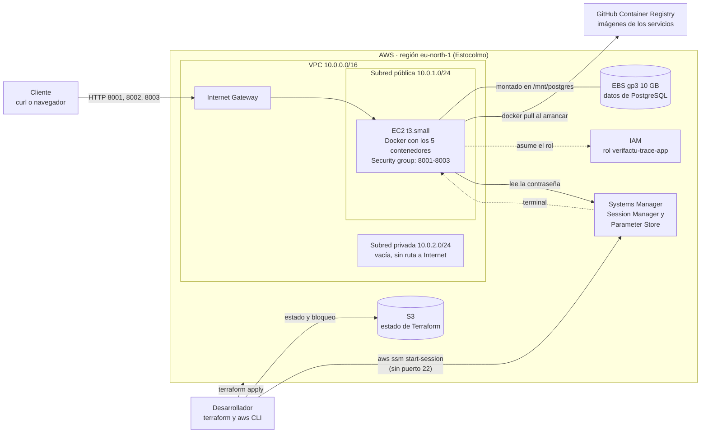
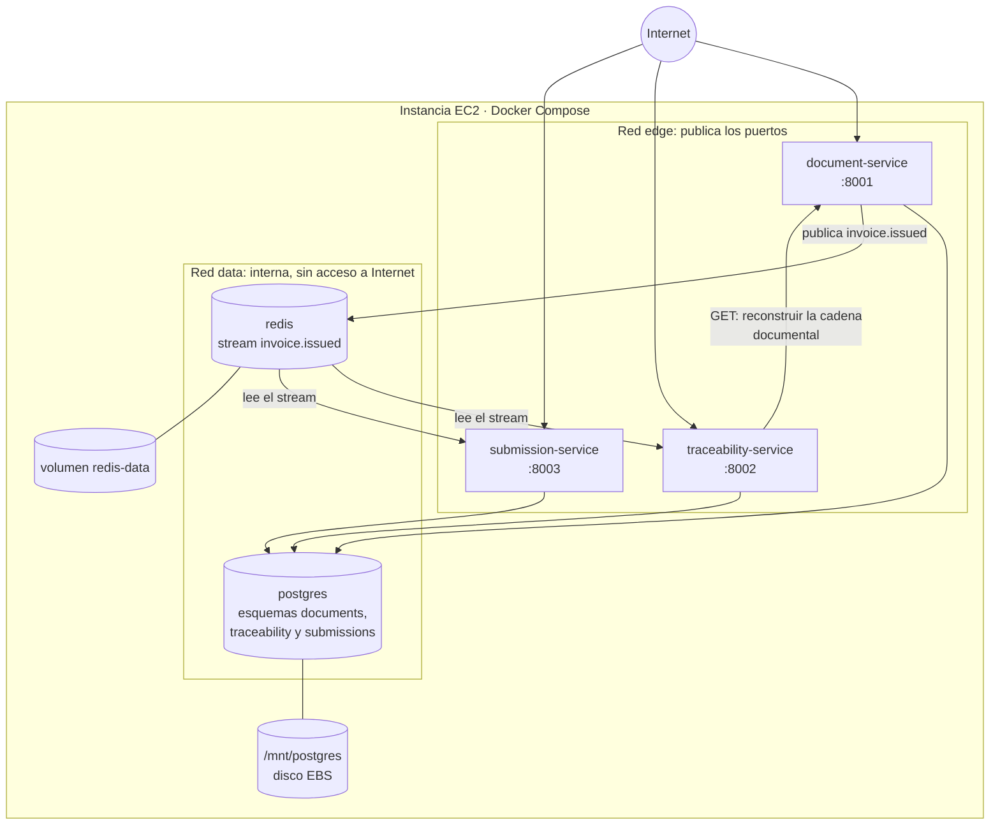
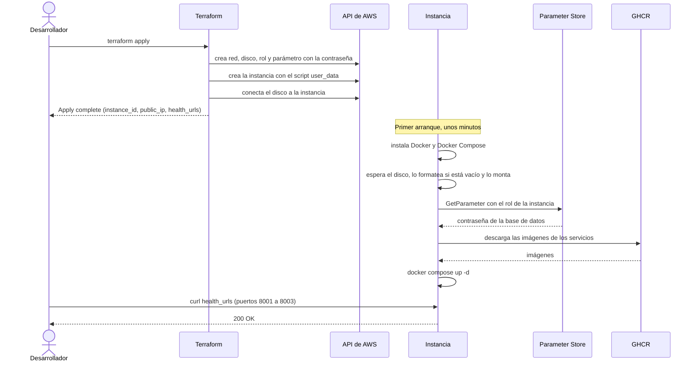

# Arquitectura de despliegue

Este documento muestra, con diagramas, qué se despliega en AWS y cómo se comunican las piezas. Los conceptos de AWS están en [`aws.md`](aws.md), el código de Terraform en [`terraform.md`](terraform.md) y las decisiones en [`hito3.md`](hito3.md). La organización interna de cada servicio está en [`arquitectura.md`](arquitectura.md).

Los diagramas son de Mermaid: GitHub los dibuja al abrir el fichero.

## Vista general

Quién habla con quién, desde fuera de AWS hasta los discos.

Cosas que el diagrama deja ver:

- **El único tráfico que entra desde Internet son los puertos de los servicios** (8001 a 8003). No hay SSH: el terminal se abre a través de Systems Manager, que es la instancia quien lo pide hacia fuera.
- **La instancia sale a Internet por el Internet Gateway** para descargar las imágenes de GHCR y hablar con Systems Manager. Por eso la subred es pública y no hay NAT.
- **La subred privada está vacía.** Se creó para separar, en el futuro, lo que no debe tener dirección pública (por ejemplo una base de datos gestionada). Hoy PostgreSQL es un contenedor y vive en la instancia.
- **El disco de datos y la instancia son recursos distintos.** El disco sobrevive a la instancia, pero no a `terraform destroy`.
- **Terraform no pasa por la instancia.** Lo ejecuta el desarrollador desde su máquina, contra la API de AWS, y guarda el estado en S3.

## Dentro de la instancia

Los cinco contenedores y las dos redes de Docker.

- Los tres servicios usan **la misma base de datos con un esquema cada uno**, y se comunican entre sí a través del *stream* de Redis, salvo una consulta: trazabilidad pide a `document-service` los documentos de una cadena (CU-11).
- PostgreSQL y Redis están en una red **interna** que no es alcanzable desde fuera ni tiene salida a Internet. Solo se publican los servicios.
- Los datos de PostgreSQL están en el disco de EBS. Los de Redis, en un volumen de Docker del disco de la propia instancia, así que **los eventos del *stream* no sobreviven a `terraform destroy`** ni a la sustitución de la instancia.

## Cómo arranca

Qué ocurre desde `terraform apply` hasta que un servicio responde.

El script deja su registro en `/var/log/verifactu-setup.log`, que se lee abriendo una sesión (ver [`aws.md`](aws.md#acceder-a-la-instancia-y-comprobarla)).

## Qué cambia en el Hito 4

- Un **gateway** será el único servicio publicado: los puertos 8001 a 8003 se cierran en el grupo de seguridad y se abre solo el del gateway.
- Un **pipeline de GitHub Actions** desplegará con un rol de IAM asumido por OIDC, sin guardar claves de acceso.
- Se acotarán las direcciones que pueden llegar a la instancia (`app_allowed_cidr_blocks` hoy admite `0.0.0.0/0`).
